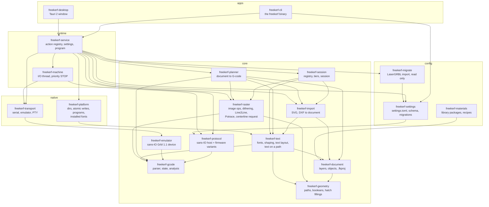
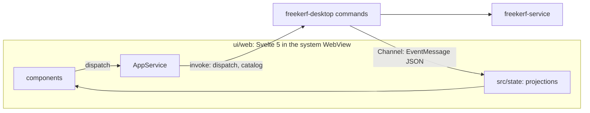

# Architecture

FreeKerf is a Cargo workspace split in layers with machine-checked dependency
rules (`cargo xtask check-layers`, PLAN §3). This page describes what exists after
M1 (the headless machine core and the `freekerf` command line) and the desktop app
of M4a.

## Layers and crates



| Layer | Crates | Rule |
| --- | --- | --- |
| core | gcode, protocol, emulator, session, geometry, document, planner, import, raster, text | no I/O, no threads of their own, no clock; builds for `wasm32-unknown-unknown` |
| config | settings, materials, migrate | core and config; settings files through the `SettingsStore` trait (materials reads package files with `freekerf-library`) |
| native | transport, platform | core only |
| runtime | machine, service | core, config, native |
| apps | cli, desktop | the service (and config for `freekerf config`) |
| testing | testkit | dev-dependency only |

`freekerf-gcode` may parse large programs on all cores (`rayon`, feature
`parallel`, on by default; the runtime enables it, the wasm build does not).

## Desktop app (M4a)



- `apps/desktop/src-tauri` (crate `freekerf-desktop`) exposes three Tauri commands:
  `dispatch(action, params)`, `catalog()` and `subscribe(channel)`. The window acts
  as `Caller { kind: User, name: "desktop", max_tier: machine }`: `laser` actions
  are refused until the fire confirmation exists (PLAN §9.5).
- `ui/web` reaches the app only through the `AppService` interface
  (`src/service.ts`); `src/ipc/` is the only code that imports Tauri, and the fake
  service of `src/dev/` (browser development, component tests) never reaches a
  production build (lint + `npm run check:bundle`).
- Types crossing the boundary are generated from the Rust schemas into
  `ui/web/src/gen/api.ts` (ADR 0015). Bulk data uses raw binary payloads (ADR 0006).
- Tokens, icons, fonts and app icons come from `freekerf/design` at the commit
  pinned in `ui/tokens/design.lock` (`cargo xtask sync-tokens`).

## Data flow

```mermaid
sequenceDiagram
  participant FE as Front end (CLI, host --stdio)
  participant S as freekerf-service
  participant M as freekerf-machine (I/O thread)
  participant H as protocol::Host (sans-IO)
  participant T as Transport (serial / emulator)
  FE->>S: dispatch("job.run", {...}) as Caller
  S->>S: tier check (laser)
  S->>M: call(|host, now| host.run_program(..))
  M->>H: run_program(now)
  H-->>M: Output::Write(bytes) ...
  M->>T: write_all(bytes)
  T-->>M: bytes (reader thread)
  M->>H: receive(bytes, now); tick(now)
  H-->>M: Event::JobEnded ...
  M-->>S: MachineEvent (subscribers)
  S-->>FE: ServiceEvent, state.get
```

- **Sans-IO protocol.** `Host` has no threads, no clock, no port: the caller reports
  bytes and time (`receive`, `tick`, `open`, `close`) and drains `poll_output`
  (bytes, close requests) and `poll_event`. `next_deadline` tells when to tick.
  Tests drive it with a simulated clock (`freekerf_testkit::Bench`), so the
  conformance scenarios run in memory in milliseconds.
- **Firmware variants** implement `Firmware` (defaults are Grbl): streaming mode,
  status query, reset command, line hooks (Marlin `M114` positions, Vigo `<VSta>`
  counters), job begin/end wrappers, hang detection.
- **One I/O thread** per machine (ADR 0001): `select!` on commands, received
  bytes and the next deadline. A reader thread per link turns blocking reads
  into messages. STOP has its own channel, drained before anything else.
- **One registry** (ADR 0004): every operation is an action with a name, a JSON
  schema, a description and a tier. `host --stdio`, the CLI and the tests all go
  through `Service::dispatch`; the tier of the caller is checked on every call.
- **Scripts** (ADR 0011): `freekerf-script` embeds QuickJS with an `app` object
  generated from the registry; `Service::run_script` runs one in a session
  transaction (one undo step, rollback on error) or as a dry run on a copy of the
  session. STOP cancels running scripts first.
- **Agents and clients** (ADR 0012): `freekerf serve` listens on the local
  endpoint (`freekerf-ipc`); `freekerf mcp` attaches to it.
  The caller's tier comes from the settings; grants above it need the person
  (`permissions`); agents never run laser actions, and only save new `.fkproj` files.

## Extension points

| I want to… | Do… |
| --- | --- |
| support a new firmware | `impl Firmware` in `freekerf-protocol/src/firmware.rs`, add a `FirmwareKind`, add it to the settings enum, tests with `Bench` |
| add a transport (Telnet, WebSocket) | `impl Transport` in `freekerf-transport`, then a `machine.connect` parameter in the service |
| add an action | `register` it in `freekerf-service` (schema from the parameter struct), pick the tier, `cargo xtask gen-docs` |
| add a setting | a field in `freekerf-settings` (with default), `host_options` if it reaches the protocol, a migration if a key moved, `cargo xtask gen-docs` |
| change what the analysis computes | `freekerf-gcode` (`MachineState`, `Program::analyze`), check the conformance goldens |
| add a front end | depend on `freekerf-service` only; dispatch actions, subscribe to events |
| import a new file format | a module in `freekerf-import` returning an `Import` (colours + objects) from bytes; a feature page |

## Key decisions

- Threads and `crossbeam-channel`, no async runtime: [ADR 0001](adr/0001-threads-not-async.md).
- Decimal numbers where LaserGRBL uses `decimal`: [ADR 0002](adr/0002-numeric-representation.md).
- Injected clock, sans-IO protocol: [ADR 0003](adr/0003-injectable-clock.md).
- One action registry with tiers: [ADR 0004](adr/0004-action-registry.md).
- Settings in TOML with a generated schema: [ADR 0005](adr/0005-settings-toml.md).
- Polygon clipping is a port of Clipper 6.4.2, for LaserGRBL-identical fillings: [ADR 0007](adr/0007-clipping-library.md).

## Generated files

| File | From | Check |
| --- | --- | --- |
| `doc/features/actions.md` | the service registry | `cargo xtask check-docs` |
| `doc/schema/settings.schema.json` | `freekerf_settings::Settings` | `cargo xtask check-docs` |
| `doc/schema/fkproj.schema.json` | `freekerf_document::Document` | `cargo xtask check-docs` |
